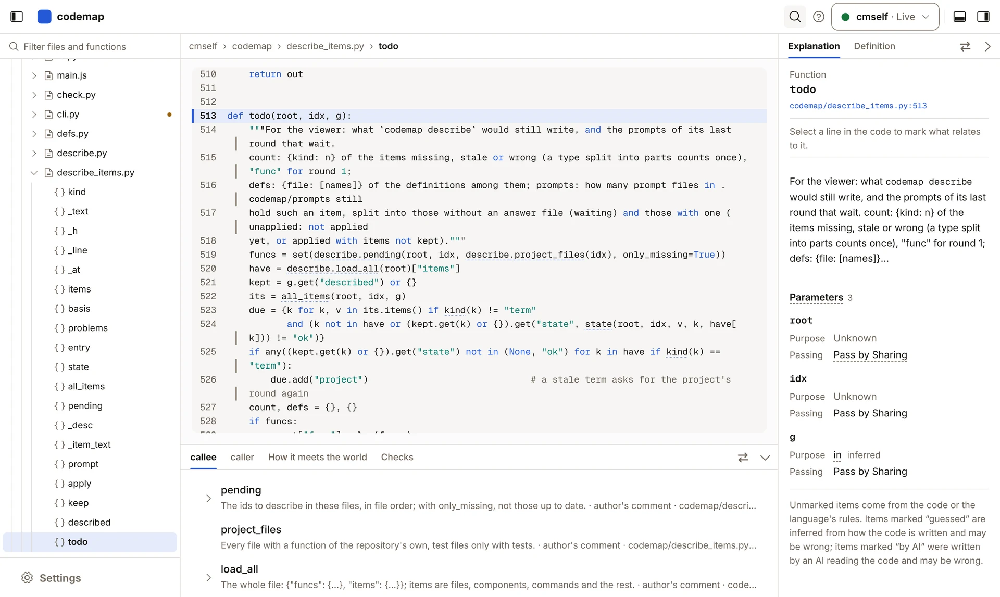

# codemap

A static map of a codebase, for people and AI agents who need to read code they did not write.

<picture>
  <source media="(prefers-color-scheme: dark)" srcset="docs/viewer-dark.webp">
  
</picture>

## About

Opening an unfamiliar repository usually means guessing where to start and grepping for who calls what.
codemap reads the code once and builds a map of it: the components and their files, every function, who
calls whom, what the program reads and writes, and what each file defines besides its functions. You read
the map in a browser laid out like a code editor, and an AI agent reads the same map from the
repository.

codemap never runs the program. That makes it useful for code that takes too long to run, needs hardware
you do not have, or is half rewritten. Calls come from each language's own compiler or type checker where
one is available, so they are exact; when codemap is not sure, the map says so instead of guessing.

## Features

- **Call graphs per language.** C and C++ through GCC (macros expanded, only the `#ifdef` branches really
  built); Python, Go and TypeScript/JavaScript through their own analyzers; Java, HTML/CSS and the rest
  through tree-sitter. Each call is marked exact, inferred or ambiguous.
- **Framework adapters** for what a framework calls by itself: Flask, FastAPI, pytest, Go `net/http`,
  Ryu/os-ken, Mininet and ONOS.
- **A viewer** with an explorer, the code with clickable calls, call trees in both directions, how far a
  change reaches, the program's entry points, commands, environment variables and files, and an
  architecture diagram of the components.
- **Definitions beside the code:** types and their fields, file-level variables, constants and macros,
  imports and exports, each with the lines and functions that use it.
- **Optional AI descriptions.** `codemap describe` writes prompts; any AI answers them; codemap checks
  every answer against the code (cited lines, names, parameters) before keeping it, and marks it stale
  when the code changes. codemap itself never calls an AI.
- **Checked notes.** `codemap check` verifies every `file:line` and `` `caller -> callee` `` claim in
  your Markdown notes against the current code.
- **Shareable.** `codemap export --html` writes one HTML file with the whole map inside, to open anywhere
  without codemap installed.

## Installation

```sh
uv tool install 'codemap[diagram,viewer] @ git+https://github.com/seanyeh77/codemap'
```

Run the same command with `--force` to update.

### Requirements

- Python 3.10 or newer. The tree-sitter grammars come as wheels, so nothing is downloaded at run time.
- For C and C++: GCC (on macOS, where `gcc` is clang, run codemap in Linux or a container) and a
  `compile_commands.json`. Without one, C and C++ are read by tree-sitter, by name only.
- For Go: the Go toolchain, used to build a small helper once. Without it, tree-sitter reads Go.
- For TypeScript and JavaScript: Node.js. Without it, tree-sitter reads them.
- The extras: `viewer` (FastAPI, uvicorn) for `codemap serve`, `diagram` (Pillow) for the architecture
  diagram.

## Usage

In the repository you want to read:

```sh
codemap index          # read the code into .codemap/index.json; run it again after the code changes
codemap serve          # open the map at http://127.0.0.1:7300/
```

On a remote machine, forward the port from your laptop with `ssh -L 7300:localhost:7300 HOST` (VS Code
Remote-SSH does this by itself). The **?** in the viewer's top bar walks through the layout in five
steps.

Not sure what to do next? Run `codemap` alone: it says where the project stands and offers the next step.

For C and C++, write `compile_commands.json` at the repository's top first, ideally without a full
build:

```sh
cmake -B build -DCMAKE_EXPORT_COMPILE_COMMANDS=ON && ln -s build/compile_commands.json .   # CMake
compiledb -n make                                                                       # Make, without building
bear -- make                                                                            # Make, with a build
```

### Add AI descriptions (optional)

Without descriptions the map still shows every call, plus the authors' own comments. To have an AI
say what each function, file, type and component does:

```sh
codemap describe                                       # prompts in .codemap/prompts/prompt-NN.md
# give each prompt to an AI and save its JSON answer as answer-NN.json beside it
codemap describe --apply .codemap/prompts/answer-*.json
codemap describe                                       # the next round, until all four are done
```

The rounds go functions, then files, types and variables, then components, then the project. An AI
agent such as Claude Code can do every round by itself from the instruction `codemap describe` prints.
While `codemap serve` runs, press 重新載入索引 (Reload index) to see new descriptions; the viewer
also lists what is still missing and any prompt that waits for an answer or for `--apply`.

### From the terminal

```sh
codemap where NAME          # the definition of NAME, and what it does
codemap callers NAME        # who calls it (-d adds what each one does)
codemap callees NAME        # what it calls
codemap check NOTES.md      # verify the file:line references and call claims in your notes
codemap export --html       # one HTML file with the map, to open anywhere
codemap -h                  # every command
```

Commit `.codemap/index.json` and `.codemap/descriptions.json` to share the map with your team or your
agent, and add `.codemap/cache/` to `.gitignore`.

## Documentation

- [The viewer](docs/viewer.md): the layout, every view, snapshots and the hosted viewer
- [AI descriptions](docs/describe.md): the four rounds, what an answer must satisfy, how it goes stale
- [How it works](docs/how-it-works.md): each language's backend, the rule scan, the guides
- [Configuration](docs/configuration.md): `.codemap/rules.json`
- [Limits](docs/limits.md): what codemap cannot see, and the cost of reading TypeScript

## Contributing

Issues and pull requests are welcome at [seanyeh77/codemap](https://github.com/seanyeh77/codemap).
[docs/development.md](docs/development.md) covers the tests and building the viewer.

```sh
git clone https://github.com/seanyeh77/codemap && cd codemap
uv run --all-extras --with pytest --with httpx2 pytest   # needs gcc; Go and TypeScript tests skip without Go or Node
cd viewer && npm install && npm test
```
