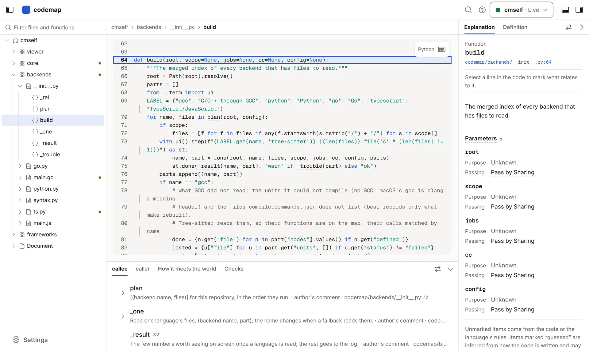
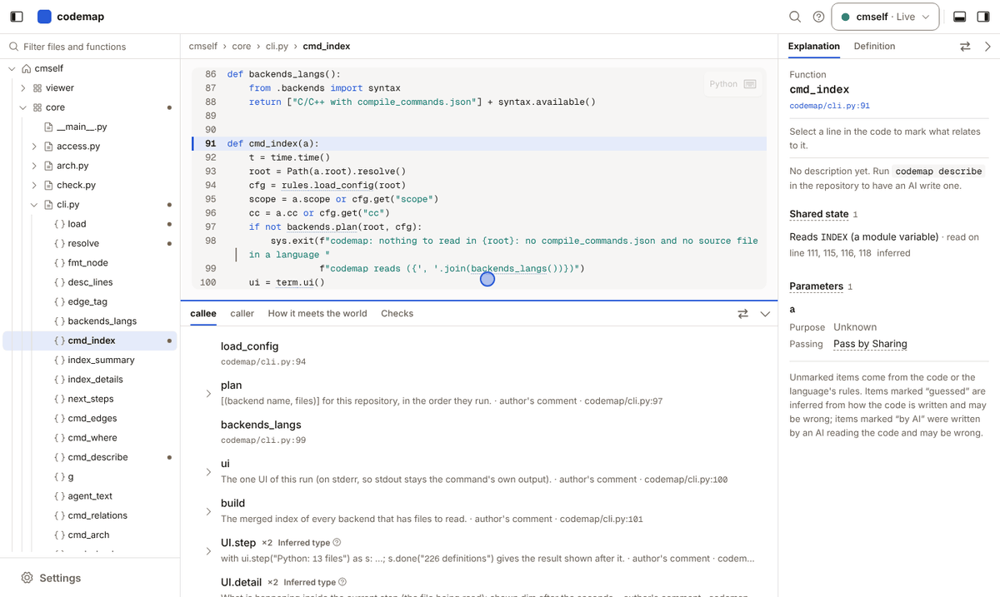
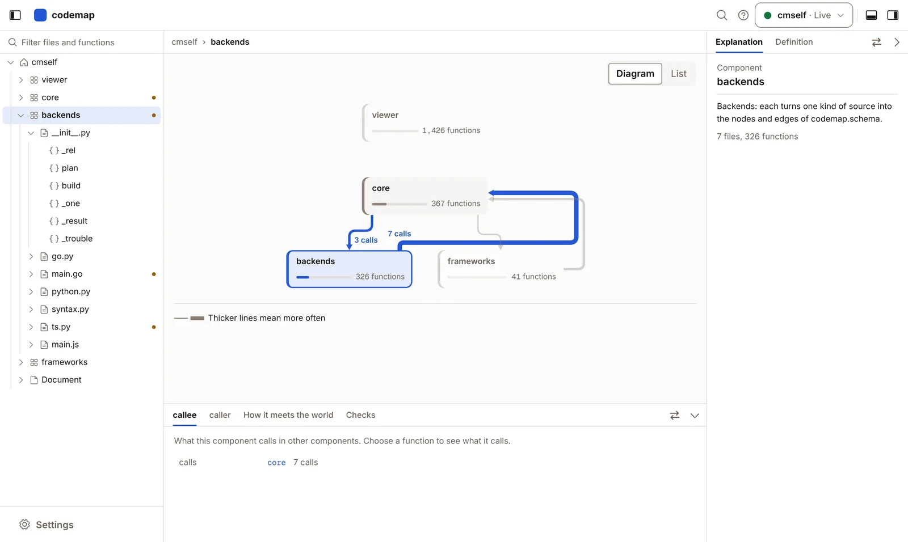
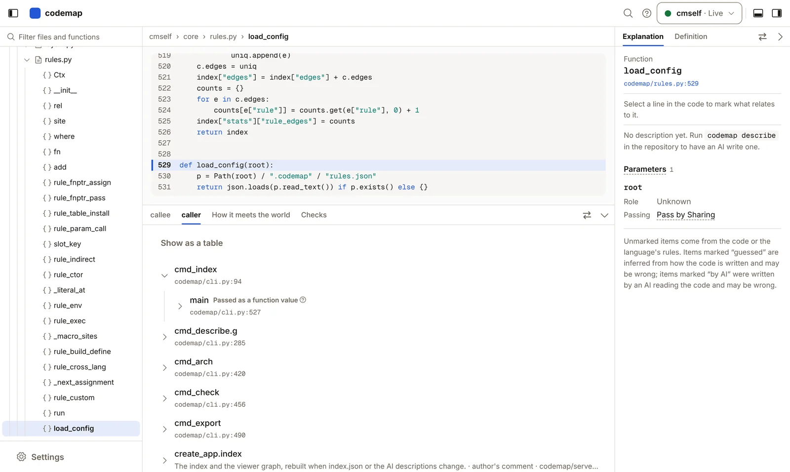
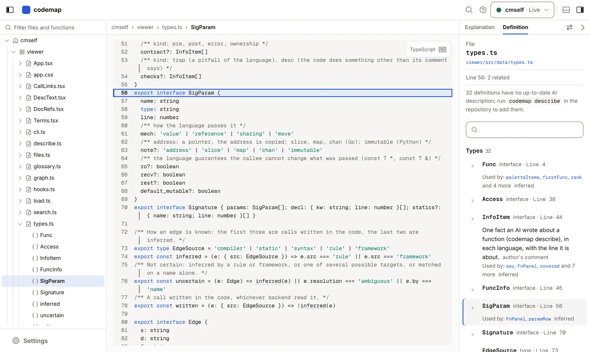
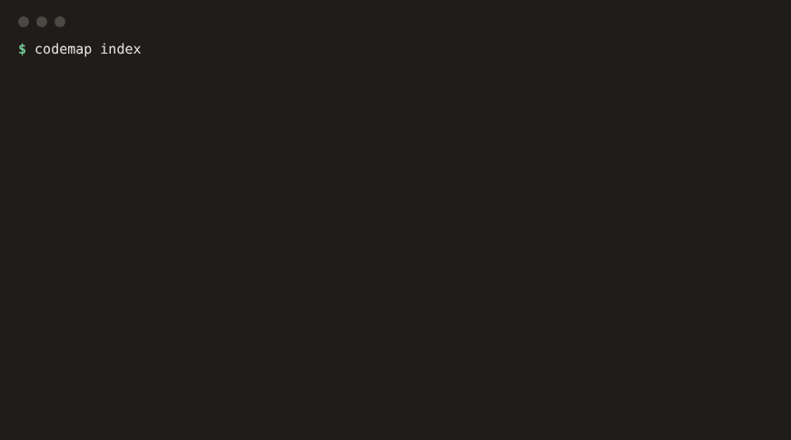
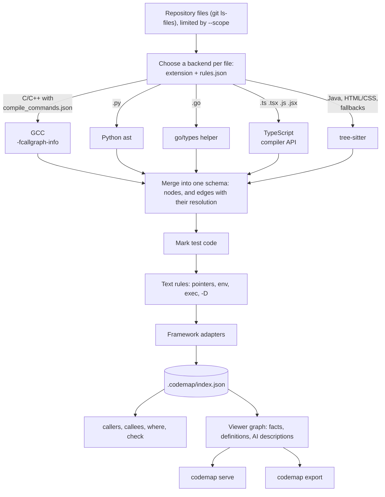

<h1 align="center">codemap</h1>

<p align="center">
  <strong>Find your way through code you did not write, without running it.</strong>
</p>

<p align="center">
  codemap reads a repository with each language's own compiler or type checker and turns it into a
  browsable map of components, functions and calls, for people and for AI agents.
</p>

<p align="center">
  <a href="https://github.com/seanyeh77/codemap/actions/workflows/pages.yml"></a>
  
  <a href="https://seanyeh77.github.io/codemap/"></a>
</p>

<picture>
  <source media="(prefers-color-scheme: dark)" srcset="docs/assets/viewer-dark.webp">
  
</picture>

<p align="center"><sub>codemap's own repository, as codemap shows it.</sub></p>

## Contents

- [Why codemap?](#why-codemap)
- [Product demo](#product-demo)
- [Features](#features)
- [Quick start](#quick-start)
- [Architecture](#architecture)
- [Supported languages](#supported-languages)
- [Configuration](#configuration)
- [Advanced usage](#advanced-usage)
- [Development](#development)
- [License](#license)

## Why codemap?

Some code is hard to read by browsing it: a C project whose calls hide behind macros, `#ifdef`
branches and function pointers; a Python service whose handlers are wired up by a framework; a
TypeScript monorepo whose packages call each other through re-exports. Grep finds names, not calls,
and an editor's "go to definition" needs the project to build and the right environment to run.

codemap takes a different route:

- **It never runs the program.** It works on code that is slow to run, needs hardware you do not
  have, or is half rewritten.
- **Calls come from the compiler where there is one.** GCC reports the calls it really compiles;
  Python's `ast`, Go's `go/types` and the TypeScript compiler resolve the rest by type.
- **It says how sure it is.** Every call is exact, inferred or ambiguous, and a call nothing decides
  is left out and counted, never guessed by name across the repository.
- **One map for people and agents.** The index is a JSON file in the repository; the same map
  answers `codemap callers` in a terminal and drives the viewer in a browser.

Typical uses: onboarding to an unfamiliar codebase, judging how far a change reaches before making
it, reviewing a partial rewrite, and giving an AI agent an accurate call graph instead of grep
results.

## Product demo

Hover a call to see what it does, Ctrl- or ⌘-click it to open it, and follow its callers:



<table>
  <tr>
    <td width="50%"></td>
    <td width="50%"></td>
  </tr>
  <tr>
    <td><b>Components.</b> Calls between components, drawn thicker the more often they happen.</td>
    <td><b>Callers.</b> Who calls a function, level by level, including functions handed on as values.</td>
  </tr>
  <tr>
    <td colspan="2"></td>
  </tr>
  <tr>
    <td colspan="2"><b>Definitions.</b> Types, variables, constants, imports and exports of the open file, with the functions that use each one.</td>
  </tr>
</table>

## Features

| Capability | What it does |
|---|---|
| **Compiler-backed call graphs** | C and C++ through GCC (`-fcallgraph-info`, macros expanded, only the `#ifdef` branches that are built); Python, Go and TypeScript/JavaScript through their own analyzers. |
| **Syntax-based fallback** | Java, HTML/CSS, and any of the above whose analyzer cannot run, through tree-sitter, with calls joined by name only where one definition has that name. |
| **Confidence on every call** | `exact`, `inferred`, `ambiguous` (one edge per possible target), or left out as unresolved. Each edge also records where it came from: compiler, static analysis, syntax, a text rule or a framework adapter. |
| **External candidate grouping** | An ambiguous call whose candidates are all library methods of one name (`id.toString()` on `string \| number`) is shown as one group, and counted apart from ambiguity inside the repository. |
| **What the compiler cannot see** | Text rules for function pointers and dispatch tables, `setenv`/`getenv` pairs, `exec`, `-D` flags in Makefiles and C names used from Python; adapters for Flask, FastAPI, pytest, Go `net/http`, Ryu/os-ken, Mininet and ONOS. |
| **Interactive viewer** | Explorer, code with linked calls, callee and caller trees, how far a change reaches, entry points, commands, environment variables and files, an architecture diagram, and each file's definitions. Light and dark, desktop and phone. |
| **Incremental caching** | GCC results are cached per translation unit and TypeScript results per program; only what changed is analyzed again. |
| **Optional AI descriptions** | `codemap describe` writes prompts for any AI and checks every answer against the code before keeping it. codemap itself never calls an AI. |
| **Checked notes** | `codemap check` verifies the `file:line` references and call claims in your Markdown notes against the current code. |

## Quick start

### Install

```sh
uv tool install 'codemap[diagram,viewer] @ git+https://github.com/seanyeh77/codemap'
```

| Needed for | Requirement |
|---|---|
| Everything | Python 3.10 or newer |
| C and C++ | GCC and a `compile_commands.json` (otherwise tree-sitter reads them by name) |
| Go | The Go toolchain (otherwise tree-sitter) |
| TypeScript and JavaScript | Node.js (otherwise tree-sitter) |

The tree-sitter grammars ship as wheels, so nothing else is downloaded at run time. On macOS, where
`gcc` is clang, run the C and C++ analysis in Linux or a container.

### Index and open the map

```sh
cd your-repository
codemap index
codemap serve
```

`codemap index` writes `.codemap/index.json` and summarizes what it read:



`codemap serve` prints the address and keeps running:

```text
codemap: the map of your-repository is at http://127.0.0.1:7300/
  after codemap index or describe, press 重新載入索引 (Reload index) in the page; Ctrl-C stops
```

On a remote machine, forward the port with `ssh -L 7300:localhost:7300 HOST`. The **?** in the
viewer's top bar walks through the layout. Not sure what to do next? `codemap` alone says where the
project stands and offers the next step.

For C and C++, write `compile_commands.json` at the top of the repository first:

```sh
cmake -B build -DCMAKE_EXPORT_COMPILE_COMMANDS=ON && ln -s build/compile_commands.json .
compiledb -n make        # or bear -- make, which also builds
```

## Architecture



1. **Language detection.** codemap lists the files git tracks (or walks the tree outside git),
   limited by `--scope`, and picks a backend by extension. `.codemap/rules.json` can turn a language or
   an analyzer off.
2. **Symbol extraction and resolution.** Each backend reads its files and writes the same schema
   (`codemap/schema.py`): a node per definition, an edge per call. The rest of codemap reads only that
   schema, so a new language is a new module in `codemap/backends/`. Files GCC could not compile go
   to tree-sitter, so their functions are still on the map.
3. **Relations beyond calls.** After test code is marked, text rules and framework adapters add
   edges the analyzers cannot see, each tagged with the rule that found it, to be read as candidates.
4. **Graph generation.** `codemap serve` and `codemap export` turn the index into the viewer's graph:
   components, per-function facts (shared state, parameters, side effects), each file's definitions,
   and any AI descriptions, with a hash that marks them stale when the code changes.

**Confidence levels**

| Resolution | Meaning |
|---|---|
| `exact` | The target is certain from the types and overrides codemap can see, or the compiler compiled the call. |
| `inferred` | Decided by a value that flows in (a constructor's result, a stored callback, an element added to a container); may be wrong. |
| `ambiguous` | Several possible targets (a union, an override, an interface): every target gets an edge. A `partial` mark says the targets listed may not be all of them. |
| not resolved | Nothing decides the target: no edge is written; the count appears in the summary. |

## Supported languages

| Language | Backend | Resolution | Important limitations |
|---|---|---|---|
| C, C++ | GCC with `compile_commands.json` | Exact for direct calls; indirect calls kept as `__indirect_call`, joined by text rules where a pointer is assigned | Needs GCC; pointers filled at run time (`dlsym`) stay unresolved; CUDA device code is not mapped. Without a database: tree-sitter, by name |
| Python | Python's `ast` | Imports, classes, MRO, `super()`, annotations, constructors, return values and containers; exact, inferred or ambiguous | Not through unannotated arguments, `**kwargs`, `getattr`, or rows read from files |
| Go | `go/types`, through a helper built with the local toolchain | Package functions and concrete methods exact; interface calls to the repository's implementing types | Build tags judged by file name; values through channels, maps and slices not followed |
| TypeScript, JavaScript | TypeScript compiler API (TS 5 or 6) through a Node helper | Static types, values through variables, fields, props and callbacks; JSX as calls; monorepo packages resolved to source | Not through arrays, maps or promises; implicit (structural) implementations of library interfaces are not found |
| Java, HTML, CSS | tree-sitter | Definitions, imports, and calls joined by name when the name decides it | No types: a method on an object of unknown type is joined only when one definition has that name |

Each file's definitions (types, variables, constants, macros, imports and exports) are read with
tree-sitter for C, C++, Python, Go, TypeScript, JavaScript and Java. The full list of limits is in
[docs/limits.md](docs/limits.md).

## Configuration

Everything is optional. Put it in `.codemap/rules.json`:

```json
{
  "scope": ["src/server", "src/common"],
  "source_scope": {"production": ["tests/tools"], "test": ["examples/"]},
  "components": {"src/server/hooks": "hooks"},
  "describe": {"src/server": "The HTTP front end; everything else is called from here."},
  "languages": {"disable": ["css"]},
  "frameworks": {"disable": ["onos"]},
  "backends": {"typescript": false},
  "disable": ["exec"]
}
```

| Key | Effect |
|---|---|
| `scope` | Analysis scope: only files under these directories are indexed (same as `codemap index --scope`). |
| `source_scope` | Source scope: which files count as test code, overriding the naming conventions (`tests/`, `test_*.py`, `_test.go`, `*.test.ts`). Test code stays indexed but is left out of the architecture diagram and of production type inference. |
| `components` | Name the components by directory instead of using the directory layout. |
| `describe` | What each component is for, in the project's own words. |
| `languages`, `frameworks` | Turn off a tree-sitter language or a framework adapter (`flask`, `fastapi`, `pytest`, `ryu`, `mininet`, `onos`, `net/http`). |
| `backends` | `false` for `python`, `go` or `typescript` sends those files to tree-sitter. |
| `disable` | Turn off text rules (`fnptr_assign`, `indirect`, `fnptr_pass`, `table_install`, `param_call`, `ctor`, `env`, `exec`, `build_define`, `cross_lang`, `custom`). |
| `cc` | The GCC to compile C and C++ with (same as `codemap index --cc`). |

`roles`, `phases`, `env`, `channels` and `custom` rules are described in
[docs/configuration.md](docs/configuration.md).

## Advanced usage

### From the terminal

```sh
codemap callers load_config    # who calls it, with file:line and how the call was found
codemap callees build          # what it calls
codemap where merge            # its definition and what is known about it
codemap relations LC_ALL       # edges from text rules about a name: pointers, env, exec
codemap check NOTES.md         # verify file:line references and call claims in notes
codemap arch                   # write an Architecture section and diagram into CODEMAP.md
```

### Sharing a map

```sh
codemap export --html          # one HTML file with the viewer and the map inside
codemap export                 # a .codemap snapshot, for https://seanyeh77.github.io/codemap/
```

Commit `.codemap/index.json` (and `.codemap/descriptions.json` if you use AI descriptions) so a teammate
or an agent starts from the same map; add `.codemap/cache/` to `.gitignore`.

### AI descriptions

```sh
codemap describe                                    # prompts in .codemap/prompts/
# give each prompt-NN.md to an AI; save its JSON answer as answer-NN.json beside it
codemap describe --apply .codemap/prompts/answer-*.json
codemap describe --status                           # up to date, stale, wrong, missing
```

There are four rounds: functions; files, types and variables; components; the project. Run
`codemap describe` again after each `--apply`. An agent such as Claude Code can run every round from
the instruction `codemap describe` prints. Answers that cite lines outside what they describe, or
name code that does not exist, are not kept. Details: [docs/describe.md](docs/describe.md).

### Incremental analysis and cache invalidation

| Cache | Where | Invalidated when |
|---|---|---|
| GCC, per translation unit | `.codemap/cache/` | The unit's compile arguments, its source, or any header it includes change |
| TypeScript, per program | `.codemap/cache/typescript/` | Any file the program read, any module lookup, the configs, the helper, TypeScript or Node change |
| `make -n` output | `.codemap/cache/make.json` | A Makefile or a build variable in the environment changes |

Python and Go are analyzed in full on every run. Measured on TanStack Query (2,153 files, 54
programs), an unchanged re-index takes 1.7 s instead of 213 s, and an edit in one example app 9.8 s;
the setup and every scenario are in [benchmarks/typescript.md](benchmarks/typescript.md).

The TypeScript cache keeps entries for 14 days and at most 2 GB. `CODEMAP_TS_CACHE=0` turns it off
and `CODEMAP_TS_CACHE_MB` changes the limit.

### Profiling and large codebases

```sh
# every number and message, not only the summary
codemap index -v
# index part of the tree, with 8 parallel GCC compile jobs
codemap index --scope src/core src/net -j 8
# per TypeScript program: what it loaded, and where the time went
CODEMAP_TS_PROFILE=1 CODEMAP_TS_DEBUG=1 codemap index
```

Every run also writes `.codemap/index.log`, and the TypeScript cache appends one line per run to
`.codemap/cache/typescript/log.jsonl` (programs replayed and rebuilt, and why).

## Development

```sh
git clone https://github.com/seanyeh77/codemap && cd codemap
# the tests need gcc; the Go and TypeScript tests skip without Go or Node
uv run --all-extras --with pytest --with httpx2 pytest
```

The viewer is a React app in `viewer/`, built into `codemap/viewer_dist/index.html`:

```sh
cd viewer
npm install
npm run dev      # with codemap serve running on port 7300
npm test
npm run build    # commit the rebuilt codemap/viewer_dist/
```

Benchmarks:

```sh
uv run python benchmarks/ts_cache_regression.py /path/to/copy --commits 30 --out /tmp/regress
uv run python tests/regress_ibtrace.py PATH_TO_IBTRACE    # after codemap index there
```

`ts_cache_regression.py` checks out commits one after another, so run it on a copy of a repository.
More in [docs/development.md](docs/development.md).

To contribute, open an issue or a pull request at [seanyeh77/codemap](https://github.com/seanyeh77/codemap).
Run the tests before sending a change; a change to the viewer also needs `npm test` and the rebuilt
`codemap/viewer_dist/`, and a change to the TypeScript backend a rerun of
[benchmarks/typescript.md](benchmarks/typescript.md) with any difference explained.

## Documentation

- [The viewer](docs/viewer.md): every view, keyboard shortcuts, snapshots and the hosted viewer
- [AI descriptions](docs/describe.md): the four rounds and what an answer must satisfy
- [How it works](docs/how-it-works.md): each backend in detail
- [Configuration](docs/configuration.md): every key of `.codemap/rules.json`
- [Limits](docs/limits.md): what codemap cannot see, and what TypeScript analysis costs

## License

The repository does not include a license file yet.
